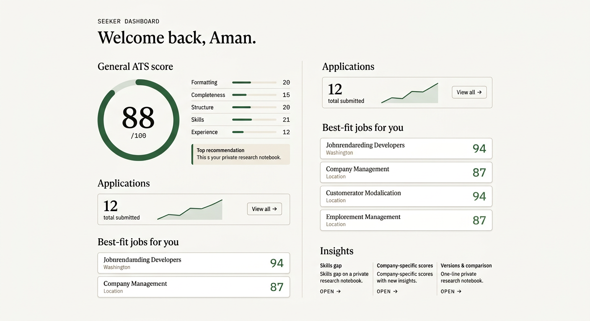

# ResuMatch

A zero-cost, full-stack recruitment platform that helps job seekers improve resume quality and helps recruiters shortlist candidates using a transparent, rule-based ATS scoring engine.

> Java 17 + Spring Boot 3.2.5 + H2 / MySQL 8 + Apache PDFBox. No paid services, no AI/ML libraries in the scoring engine.



## Highlights

- **Transparent scoring** — the same formula and breakdown is shown to both candidate and recruiter
- **Two cooperating services** — `GeneralScoreService` for resume-only scoring, `CompanyScoreService` for (resume, job) matching
- **Three-sided workflow** — Seeker, Recruiter, Admin
- **Resume parsing** — PDF, DOCX, and TXT
- **One-click demo seeder** — populates 3 seekers, 3 recruiters, 6 jobs, 15 applications, 1 pending moderation report
- **Live scoring widget** on the public landing page — paste skills, get a projected score, no signup required
- **Optional Gemini integration** with a deterministic template fallback — works fully without any API key

---

## Features

### For job seekers

- Register with name, email, phone, password
- Upload resume (PDF, DOCX, TXT — max 10 MB)
- Get a **general ATS score (0–100)** with 5 sub-scores: formatting, completeness, structure, skills, experience
- See an **explainable score breakdown** — every point traceable to a rule
- Browse and filter open jobs, apply with one click
- See a **company-specific score** for every applied job (matched / missing skills + ranked recommendations)
- **What-if simulator** — add a hypothetical skill and see your projected score instantly
- **Skills gap insight** — see which must-have skills you consistently miss across applications
- Track application status with a full audit trail
- **Download PDF ATS report**
- **Version comparison** — see what changed between two resume versions and the score delta

### For recruiters

- Register with company + recruiter details
- Post jobs with **must-have / nice-to-have** skills and numeric weights
- See applicants ranked by score (descending) with full match/miss breakdown
- Update application status (Applied / Under Review / Shortlisted / Rejected) with an audit trail
- **Bulk action by score band** — e.g. shortlist everyone scoring 80+
- Per-job analytics: total applicants, shortlist rate, average score, top missing skills
- Close / open jobs anytime

### For admins

- Platform metrics: users, jobs, applications, pending reports
- Disable / enable user accounts
- Close / open any job
- **Moderation queue** — review seeker reports on jobs (dismiss, close job, disable recruiter)
- **One-click demo data seeder** for viva and demonstration

### Cross-cutting

- **Synonym/alias-aware** skill matching — `js → javascript`, `reactjs → react`, `node js → node.js`, `mysql server → mysql`, `c++ → cpp`
- **Rule-based, fully explainable** scoring (no AI/ML libraries in the engine)
- Session-based auth with **rate limiting** on failed logins
- Password reset via email token (logged to console in dev mode)
- Optional 2FA scaffold (email OTP — table ready, UI toggle settable per user)
- Seeded skills dictionary (50+ canonical skills, 200+ aliases) and an admin user

---

## Architecture

```
Browser
  │  HTML / CSS / vanilla JS + Chart.js (no SPA framework)
  │
  ▼
Spring Boot 3.2 (Java 17)
  │
  ├── Controllers  ──►  Services  ──►  Repositories
  │     auth, resume, jobs, applications, admin, dashboards
  │
  ├── ATS Engine (pure rule-based, no ML)
  │     TextNormalizer · SectionDetector · AliasIndex
  │     GeneralScoreService · CompanyScoreService
  │     FormattingChecker · AtsWeights
  │
  ├── Notifications (async, log + persist)
  ├── PDF reports (Apache PDFBox)
  └── AI description (Gemini, with template fallback)
  │
  ▼ JPA
Database
  ├── MySQL 8 (production)
  └── H2 file mode (dev fallback, ./data/resumatch.mv.db)
```

**Packages:** `auth`, `user`, `resume`, `parsing`, `skills`, `ats`, `jobs`, `applications`, `dashboards`, `admin`, `notifications`, `reports`, `ai`, `common`, `config`. 92 Java files, modular monolith, single deployable JAR.

---

## Scoring formulas

Both are pure rule-based and fully traceable. All weights live in a single file (`ats/AtsWeights.java`) — change them in one place, both services pick them up.

### General ATS (out of 100)

| Component     | Max | Signal |
|---------------|----:|--------|
| Formatting    |  20 | Severity-weighted deductions from `FormattingChecker` flags |
| Completeness  |  15 | Email + phone + name + summary presence |
| Structure     |  20 | Up to 6 standard sections detected |
| Skills        |  25 | Distinct canonical skills found (penalised if no Skills section) |
| Experience    |  20 | Years (date-range heuristic) + projects presence |

### Company-specific (out of 100)

| Component      | Max | Signal |
|----------------|----:|--------|
| Must-have      |  50 | `sum(matched weights) / sum(all weights) × 50` |
| Nice-to-have   |  20 | `sum(matched weights) / sum(all weights) × 20` |
| Experience     |  15 | Estimated years (capped at 5y) |
| Education      |   5 | Degree keyword + section presence |
| Formatting     |  10 | Deductions for high / medium severity flags |

Every score persists a JSON explanation with matched and missing skills, weights, and top recommendations — the same payload is shown on the seeker's detail panel and the recruiter's applicant dossier.

---

## Run it locally

### Prerequisites

- Java 17 or 21
- Maven 3.9+
- (Optional) MySQL 8

### Quick start — H2 file-backed, zero setup

**Windows (easiest):** just double-click `run.bat`. It auto-detects your MySQL and uses it if configured, otherwise falls back to H2.

**Mac / Linux:** `./run.sh`

**Manual:**
```bash
cd resumatch
mvn -DskipTests package
java -jar target/resumatch.jar
# open http://localhost:8080
```

The default profile (`h2`) uses an H2 file in `./data/resumatch.mv.db` so data persists between restarts. To wipe data, delete the `data/` and `storage/` folders.

### With MySQL

Edit `run.bat` (Windows) or `run.sh` (Mac/Linux) and set the `DB_*` values, then run the script. The app will auto-detect and use MySQL.

Or run manually:
```bash
SPRING_PROFILES_ACTIVE=mysql \
  DB_HOST=localhost DB_PORT=3306 \
  DB_NAME=resumatch DB_USER=root DB_PASS=yourpassword \
  java -jar target/resumatch.jar
```

Schema is auto-created by Hibernate on first run (`ddl-auto=update`).

### Run tests

```bash
mvn test
```

### Demo flow

1. Open `http://localhost:8080`
2. **Job seeker** — click "I'm a job seeker", register, upload a PDF or DOCX resume, see your score, matched skills, formatting flags, and recommendations
3. **Recruiter** — in a private window, click "I'm a recruiter", register, post a job with weighted skills
4. As the seeker, browse jobs, apply, see your **company-specific score** in real time
5. Back as the recruiter, open the job's "Applicants" page to see the **ranked applicant list** with full breakdowns and status controls
6. **Admin** — log in at `/pages/admin-login.html` with `admin@resumatch.local` / `Admin@123`, then click **"Seed demo data"** to populate the platform with one click

### Demo accounts (after seeding)

| Role       | Email                     | Password       |
|------------|---------------------------|----------------|
| Admin      | `admin@resumatch.local`   | `Admin@123`    |
| Seeker 1   | `priya@demo.com`          | `Demo123pass`  |
| Seeker 2   | `rohan@demo.com`          | `Demo123pass`  |
| Seeker 3   | `aisha@demo.com`          | `Demo123pass`  |
| Recruiter  | `riya@technova.com`       | `Demo123pass`  |
| Recruiter  | `arjun@datapath.com`      | `Demo123pass`  |
| Recruiter  | `meera@orbitstudios.com`  | `Demo123pass`  |

---

## Deploy it

The app ships as a single self-contained JAR, so it runs anywhere with Java 17.

### Docker (Render / Railway / Koyeb / any VPS)

The included `Dockerfile` builds the JAR and ships it on a slim JRE image.

```bash
docker build -t resumatch .
docker run -p 8080:8080 -e RESUMATCH_AUTO_SEED=true resumatch
# open http://localhost:8080
```

On **Render**, set the runtime to `Docker` and the health check path to `/api/health`.

> `/api/health` deliberately touches **no database**, so it answers in ~3ms. An earlier
> version pointed the healthcheck at `/api/public/needs-seed`, which queries JPA
> repositories — under lazy initialization the first call rebuilt the entire
> Hibernate `EntityManagerFactory` *inside* the healthcheck request, timed out,
> and Render reported 502 Bad Gateway. Don't point a healthcheck at a DB-backed route.

### Plain JAR (no Docker, no account needed)

```bash
mvn -DskipTests package
java -jar target/resumatch.jar
```

### Cloud notes

- `SPRING_PROFILES_ACTIVE=h2` + `RESUMATCH_AUTO_SEED=true` is the zero-config combo.
  The auto-seeder repopulates demo data on every boot, which matters because
  free-tier containers have an **ephemeral filesystem** — the H2 file is wiped on
  every redeploy and every spin-down.
- For real persistence, point `DB_HOST` / `DB_USER` / `DB_PASS` at a managed
  MySQL and set `SPRING_PROFILES_ACTIVE=mysql`.

Full deployment guide and troubleshooting: **[DEPLOYMENT.md](DEPLOYMENT.md)**.

---

## API surface (selected)

All endpoints live under `/api` and return a uniform JSON envelope: `{ success, message, data, errors }`.

| Method | Path                                              | Auth      | Purpose                                       |
|--------|---------------------------------------------------|-----------|-----------------------------------------------|
| POST   | `/api/auth/register/seeker`                       | —         | Create seeker, lands on dashboard             |
| POST   | `/api/auth/register/recruiter`                    | —         | Create recruiter + company                    |
| POST   | `/api/auth/login`                                 | —         | Login by email or display name                |
| POST   | `/api/auth/forgot-password`                       | —         | Email reset token (logged in dev)             |
| POST   | `/api/auth/reset-password`                        | —         | Apply new password with token                 |
| POST   | `/api/auth/2fa/send-otp`                          | session   | Trigger email OTP (when 2FA enabled)          |
| POST   | `/api/seeker/resumes/upload`                      | SEEKER    | Multipart resume, returns parse + score       |
| GET    | `/api/seeker/resumes`                             | SEEKER    | List versions + scores                        |
| GET    | `/api/seeker/resumes/{id}/general-score`          | SEEKER    | One score with explanation                    |
| GET    | `/api/seeker/resumes/history`                     | SEEKER    | Trend series for Chart.js                     |
| GET    | `/api/seeker/jobs?location=&skill=&title=`        | SEEKER    | Browse open jobs with filters                 |
| POST   | `/api/seeker/jobs/{id}/apply`                     | SEEKER    | Apply, triggers company score                 |
| GET    | `/api/seeker/applications`                        | SEEKER    | My applications with status + score           |
| GET    | `/api/seeker/company-scores`                      | SEEKER    | All company scores, ranked                    |
| POST   | `/api/seeker/simulate-score`                      | SEEKER    | What-if with hypothetical skills              |
| GET    | `/api/seeker/skills-gap`                          | SEEKER    | Top missing must-have skills                  |
| GET    | `/api/seeker/reports/{versionId}/pdf`             | SEEKER    | Download ATS PDF report                       |
| POST   | `/api/recruiter/jobs`                             | RECRUITER | Create job with weighted skills               |
| PATCH  | `/api/recruiter/jobs/{id}/status`                 | RECRUITER | OPEN / CLOSED / FILLED                        |
| GET    | `/api/recruiter/jobs/{id}/applicants`             | RECRUITER | Ranked by score desc                          |
| PATCH  | `/api/recruiter/applications/{id}/status`         | RECRUITER | Update + audit                                |
| GET    | `/api/recruiter/applications/{id}/history`        | RECRUITER | Status timeline                               |
| GET    | `/api/recruiter/jobs/{id}/analytics`              | RECRUITER | Top missing skills + averages                 |
| POST   | `/api/recruiter/jobs/{id}/bulk-status`            | RECRUITER | Bulk update by score band                     |
| GET    | `/api/admin/dashboard`                            | ADMIN     | Platform metrics                              |
| PATCH  | `/api/admin/users/{id}/status`                    | ADMIN     | Disable / enable                              |
| PATCH  | `/api/admin/jobs/{id}/status`                     | ADMIN     | Override job status                           |
| POST   | `/api/admin/seed-demo-data`                       | ADMIN     | One-click demo seeder                         |
| POST   | `/api/admin/reset-demo-data`                      | ADMIN     | Wipe all data (admin preserved)               |
| POST   | `/api/public/score-demo`                          | —         | Public landing-page live scoring widget       |
| GET    | `/api/public/needs-seed`                          | —         | First-run banner check                        |
| GET    | `/api/health`                                     | —         | Liveness check — no DB access, ~3ms response  |
| GET    | `/api/health/live`                                | —         | Alias of `/api/health`                       |

---

## Configuration

All configuration is externalised via environment variables. **No secrets in source code.**

| Variable                    | Default                  | Purpose                                    |
|-----------------------------|--------------------------|--------------------------------------------|
| `PORT`                      | `8080`                   | HTTP port                                  |
| `DB_HOST`                   | `localhost`              | MySQL host (mysql profile)                 |
| `DB_PORT`                   | `3306`                   | MySQL port                                 |
| `DB_NAME`                   | `resumatch`              | MySQL database name                        |
| `DB_USER`                   | `root`                   | MySQL user                                 |
| `DB_PASS`                   | `root`                   | MySQL password                             |
| `SPRING_PROFILES_ACTIVE`    | `h2`                     | Set to `mysql` to switch database          |
| `RESUMATCH_STORAGE`         | `${user.dir}/storage`    | Where uploaded files are kept              |
| `GEMINI_API_KEY`            | (unset)                  | Enables AI description; falls back if unset|
| `RESUMATCH_AUTO_SEED`       | `false`                  | Seed demo data on boot (cloud deploys)     |

---

## Project layout

```
resumatch/
├── pom.xml
├── README.md
├── preview-dashboard.png
└── src/
    ├── main/
    │   ├── java/com/resumatch/
    │   │   ├── ResuMatchApplication.java
    │   │   ├── auth/          PasswordService, AuthService, AuthController
    │   │   ├── user/          entities + repos
    │   │   ├── skills/        Skill, SkillAlias, AliasIndexService, SkillSeed
    │   │   ├── parsing/       ResumeParser (PDFBox + POI)
    │   │   ├── resume/        ResumeService + Controller + entities
    │   │   ├── ats/           TextNormalizer, SectionDetector, AliasIndex,
    │   │   │                  FormattingChecker, AtsWeights,
    │   │   │                  GeneralScoreService, CompanyScoreService
    │   │   ├── jobs/          JobService + JobController + PublicJobController
    │   │   ├── applications/  ApplicationService + Controller + status history
    │   │   ├── dashboards/    Seeker & recruiter summary APIs
    │   │   ├── admin/         AdminController, AdminSeedController, ModerationController
    │   │   ├── notifications/ EmailService (async, log + persist)
    │   │   ├── reports/       ReportService (PDFBox) + ReportController
    │   │   ├── ai/            GeminiService + AiController
    │   │   ├── common/        Role, Status, ApiResponse, GlobalExceptionHandler, AdminSeed
    │   │   └── config/        WebMvc + static-storage config
    │   └── resources/
    │       ├── application.properties         (H2 default)
    │       ├── application-mysql.properties
    │       └── static/
    │           ├── index.html
    │           ├── css/app.css
    │           ├── js/app.js
    │           └── pages/   auth + dashboards for all roles
    └── test/java/com/resumatch/ats/
        ├── TextNormalizerTest.java
        └── CompanyScoreServiceTest.java
```

---

## Tests

`mvn test` runs the JUnit suite (10 tests, ~1s).

Notable coverage:
- Alias matching against the canonical skill dictionary
- Substring regression test — `JavaScript` must not be matched as `Java` (regression for a real bug)
- Normaliser edge cases (C++, C#, multi-word skills, hyphens, slashes)
- Company score service: must-have vs nice-to-have weighting, experience cap, formatting cap

---

## License

This project is for academic submission. All rights reserved by the authors.

## Authors

Final-year project, Department of Information Technology, G.L. Bajaj Institute of Technology and Management.

- **Shudanshu Sanjay Bora** (Group Leader)
- Ketan Saini
- Shivang Singh
- Sajal Rathore

Guided by **Ms. Pooja Tomar**, Assistant Professor, Department of IT.
